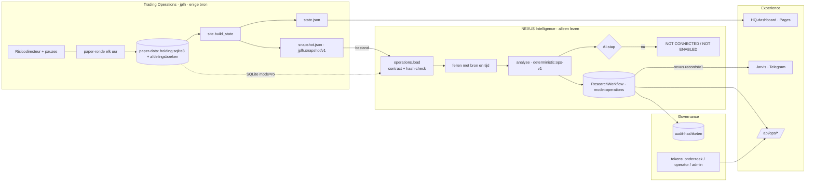

# Master Prompt 8.0: Project Unification

*JP-Libau Holding is het platform. NEXUS is de onderzoekslaag eronder. De bestaande handelsbot blijft de enige bron van portefeuille, risico en handel.*

- **Datum:** 23 november 2026
- **Branch:** `claude/project-thread-ektafa`, vanaf `main` @ `7645972`
- **Statuswoorden:**
  - IMPLEMENTED: de code bestaat.
  - TESTED: er zijn tests en die slagen.
  - CONNECTED: de onderdelen praten met elkaar.
  - DEPLOYED: het staat ergens online.
  - OPERATIONAL: het draait echt, met bewijs uit de runtime.
  - SIMULATED: de data is nep.
  - BLOCKED: het kan niet draaien door een ontbrekende sleutel, host of akkoord.
  - VALIDATED: het is aantoonbaar nuttig.

## In het kort

- **De bot zelf is niet aangeraakt.** Niets in handel, orders, boekhouding, planning, limieten of pauzes is veranderd. Crypto Lab en De Kluis blijven gepauzeerd. Live handelen staat uit.
- **Er is nu één geversioneerd contract, `jplh.snapshot/v1`.**
  - De holding maakt het bij elke dashboardronde. Het bevat dezelfde getallen als `state.json`, met een hash en versheidsgegevens.
  - NEXUS leest dat contract, of opent de holding-databases zelf alleen-lezen (SQLite `mode=ro`).
- **Er is een read-only onderzoeksstroom.** De stappen:
  1. Een vraag komt binnen.
  2. NEXUS haalt een gecontroleerde snapshot op.
  3. Daarbij komen de marktdata uit diezelfde snapshot.
  4. Daaruit worden feiten gemaakt, elk met een id, bron en tijd.
  5. Vaste code doet de analyse (`deterministic:ops-v1`).
  6. De AI-stap meldt eerlijk NOT CONNECTED.
  7. Het record wordt opgeslagen, met een regel in het auditlog.
  8. Het record is op te vragen via de API, de CLI en Jarvis (`/onderzoek`).
- **Dit is aangetoond op de echte paper-stand van vandaag.** De holding-bestanden waren voor en na byte voor byte gelijk.
- **Tests:**
  - jplh: 143 geslaagd (138 bestaande plus 5 nieuwe).
  - NEXUS: 215 geslaagd (205 bestaande plus 10 nieuwe).
- **Nog niets staat online van NEXUS.**
  - NEXUS is niet DEPLOYED en niet OPERATIONAL.
  - AI is BLOCKED, omdat er geen sleutels zijn.
  - Na merge publiceert het dashboard één extra bestand: `snapshot.json`.

## 1. Repository- en branch-audit

| Branch | Stand | Advies |
|---|---|---|
| `main` | `7645972` (merge #32). Bevat jplh (bot, dashboard, Jarvis) en `nexus/` (backend en web). | basis |
| `paper-data` | De databranch van de bot. Laatste ronde 23-11 15:10 UTC; elk uur een commit. | niet aanraken |
| `claude/project-thread-gyycqq` | Geen commits die niet al in `main` zitten (#25–#32 zijn gemerged). | verouderd; weghalen alleen als de CEO dat zegt |
| `claude/project-thread-ektafa` | Deze milestone. | PR, niet mergen zonder CEO |

**Workflows**
- `paper.yml`: elk uur een paper-ronde, bijwerken van `paper-data` en uitrol van GitHub Pages.
- `jarvis.yml`: elke 10 minuten.
- `heartbeat.yml`: houdt de planning wakker.
- `ci.yml`: de jobs `tests`, `backtest`, `databronnen`, `nexus` en `nexus-visual`.

Er is **geen** workflow die NEXUS uitrolt of laat draaien.

## 2. PR #30, #31 en #32

| PR | Inhoud | Status |
|---|---|---|
| #30 | Milestone C: activatietest, event-workflows, onafhankelijke evaluatie, providerstatussen | gemerged 13-11 |
| #31 | Milestone D (APEX): workstation, command center 6.0, AI HQ 2.0, Decision Theater | gemerged 13-11 |
| #32 | Genesis E0 + E1: onderzoeksorganisatie, Prediction Ledger, CEO Control Center | gemerged 13-11. CI op de head-commit groen: `nexus`, `tests`, `backtest`, `nexus-visual`, `databronnen`. |

Er zijn geen open PR's of conflicten.

## 3. Werkelijke uitrolstatus (runtime-bewijs van 23-11)

| Onderdeel | Status | Bewijs |
|---|---|---|
| Paper-ronde (`jplh run`) | OPERATIONAL | `paper.yml` 15:08 UTC success; commit "Paper-ronde 2026-11-23T15:10Z" op `paper-data` |
| GitHub Pages-dashboard | DEPLOYED, OPERATIONAL | De deploy-stap in `paper.yml` slaagt elk uur. De sandbox kan github.io niet bereiken, dus ik heb het lokaal opgebouwd uit `paper-data`: 0 consolefouten op desktop en mobiel. |
| Jarvis (Telegram) | OPERATIONAL | `jarvis.yml` elke 10 minuten success. Eén mislukte `luisteren`-run vandaag, daarna weer groen. |
| Risicopauzes | OPERATIONAL | Crypto Lab gepauzeerd op 14-11 (daling 15,6%), De Kluis op 20-11 (15,1%) |
| NEXUS-backend en -web | IMPLEMENTED, TESTED, niet DEPLOYED | Geen host en geen workflow. CI test alleen een demo met SIMULATED data. |
| NEXUS AI (gateway, council, genesis A–D) | IMPLEMENTED, TESTED, BLOCKED | Geen API-sleutels; de proxy blokkeert feed-, markt- en on-chain-hosts (zie `docs/ASCENSION-C-ACTIVATION.md`) |

## 4. Module-inventaris

| Module | Bron | Status | Data | Afhankelijk van | Advies |
|---|---|---|---|---|---|
| Afdelingen, holding, broker, ledger | `src/jplh/{desks,holding,broker,ledger}.py` | OPERATIONAL | echt (Bitvavo, Yahoo), vertraagd | GitHub Actions, `paper-data` | **reuse**: de enige bron van handel en portefeuille |
| Risicodirecteur, limieten, pauze | `riskdirector.py`, `risk.py` | OPERATIONAL | echt | holding | **reuse**: de enige bron van risico |
| Verkenners, Academie, coaches, arena, lab | `scouts.py`, `academy.py`, `coach.py`, `arena.py`, `research.py` | OPERATIONAL | echt | holding | **reuse** |
| Jarvis (Telegram) | `jarvis.py`, `commands.py` | OPERATIONAL | echt | Telegram-secret | **reuse**: de enige assistent voor de CEO |
| HQ-dashboard (stad, Jarvis-brein, factsheet) | `src/jplh/hq/*.html` | DEPLOYED, OPERATIONAL | echt | Pages | **adapt** in 9.0 |
| **Snapshot-contract (nieuw)** | `src/jplh/contract.py` | IMPLEMENTED, TESTED (na merge DEPLOYED via Pages) | echt | `build_state` | **reuse** als interface |
| NEXUS-brug | `nexus/backend/nexus/bridge.py` | IMPLEMENTED, TESTED | echt als `NEXUS_HOLDING_HOME` gezet is | jplh | **adapt**: opent de databases nu nog lezen+schrijven (zie de beveiligingsbevindingen) |
| **Operationeel onderzoek (nieuw)** | `nexus/operations.py`, `operations_api.py`, `ops_cli.py` | IMPLEMENTED, TESTED, CONNECTED (op een kopie van `paper-data`) | echt, DELAYED | contract | **reuse** |
| NEXUS paper-account, voorstellen, orders | `paper.py`, `proposals` in `app.py` | IMPLEMENTED, TESTED | SIMULATED vullingen | eigen database | **consolidate/retire**: een tweede portefeuille is in strijd met "één bron". Hoogstens een sandbox, nooit tonen als de holding. |
| Risk Guardian | `guardian.py` | IMPLEMENTED, TESTED | gebruikt de brug | brug | **adapt**: alleen reviewer op de snapshot, geen tweede set limieten |
| Noodstop | `controls.py` | IMPLEMENTED, TESTED | deelt het `KILL`-bestand van jplh | dezelfde bestandsmap | **defer**: niet verbonden, want de bot draait in Actions |
| AI Gateway, providers, Council, debat, Copilot | `ai_gateway.py`, `providers.py`, `council.py`, `debate.py`, `copilot.py` | IMPLEMENTED, TESTED, BLOCKED | geen | API-sleutels | **reuse** zodra er budget en akkoord is |
| Genesis-onderzoek en evaluatie | `genesis.py`, `genesis_eval.py`, `agent_specs.py` | IMPLEMENTED, TESTED; variant A (vaste code) werkt | historisch (dagkoersen) | research-database | **reuse** |
| Prediction Ledger | `ledger.py` | IMPLEMENTED, TESTED | niet in gebruik | NEXUS-database | **consolidate** met de Academie-voorspellingen (zie 12) |
| News Reactor, Social Radar, external | `news.py`, `social.py`, `external.py`, `workflow.py` | IMPLEMENTED, TESTED, BLOCKED | geen (host en sleutel) | feeds, X | **defer** |
| Strategy Lab, Evolution Lab, alpha, champion, holdout, Sentinel | `lab.py`, `evolution*.py`, `alpha.py`, `champion.py`, `holdout.py`, `sentinel_api.py` | IMPLEMENTED, TESTED | historisch | research-database | **reuse**; de holdout-grenzen blijven staan |
| Workstation, Market Pulse, Decision Theater, AI HQ | `workstation.py`, `apex_api.py`, `nexus/web/app/*` (27 routes) | IMPLEMENTED, TESTED (demo) | echte candles, maar alleen lokaal | Next.js en een API-server | **adapt**: losse componenten naar het nieuwe dashboard |
| SaaS (plannen, facturen, organisaties) | `db.py`, `/api/admin` | IMPLEMENTED, inactief | geen | – | **defer/retire**: hoort niet bij de missie |
| Docker Compose en TimescaleDB | `nexus/docker-compose.yml` | IMPLEMENTED | – | host | **defer** |

## 5. Eenduidige architectuur



**Grenzen in code**
- NEXUS schrijft nooit in de holding-map.
- NEXUS kan geen order plaatsen, limiet wijzigen of pauze opheffen.
- Een onderzoeksrecord is een onderzoeksprioriteit, geen handelsadvies.

## 6. Gewijzigde en nieuwe bestanden

| Bestand | Wat |
|---|---|
| `src/jplh/contract.py` (nieuw) | `jplh.snapshot/v1`- en `nexus.records/v1`-contracten, plus de controles: schema, hash, verboden velden en `live_trading=false` |
| `src/jplh/site.py` | Schrijft na `state.json` ook `snapshot.json` (4 regels). `state.json` blijft gelijk. |
| `src/jplh/commands.py` | Nieuw Jarvis-commando `/onderzoek`: leest `<home>/intelligence/records.json` alleen-lezen en zegt eerlijk "NIET VERBONDEN" als dat bestand er niet is |
| `nexus/backend/nexus/operations.py` (nieuw) | Alleen-lezen snapshot, versheid, feiten, analyse, AI-status, opslag en export |
| `nexus/backend/nexus/operations_api.py` (nieuw) | `/api/ops/snapshot`, `/api/ops/research` (GET en POST), `/api/ops/research/{trace}` en `/api/ops/export` |
| `nexus/backend/nexus/ops_cli.py` (nieuw) en `pyproject.toml` | `nexus-ops snapshot`, `nexus-ops research` en `nexus-ops show` |
| `nexus/backend/nexus/app.py` | De nieuwe API inhangen |
| `nexus/backend/nexus/genesis.py`, `genesis_api.py` | Records met mode "operations" tellen niet mee voor de Genesis-daglimiet en de kostenstatistiek; ze worden getoond als variant "operations" |
| `tests/test_contract.py`, `nexus/backend/tests/test_operations.py` (nieuw) | Contract-, integratie-, regressie- en beveiligingstests |

Ongewijzigd zijn alle bestanden die handel, risico, boekhouding of planning raken: `desks`, `holding`, `broker`, `ledger`, `risk*`, `paper.py` en `.github/workflows`.

## 7. Integratiecontracten

**`jplh.snapshot/v1`**: gemaakt door de holding, gelezen door NEXUS en (later) het dashboard.
- `schema`
- `source` {system, name, mode, demo, authoritative}
- `generated_at`, `exported_at`
- `freshness` {state_generated_at, last_round_at, instruments, stale_instruments}
- `holding` {capital, equity, pnl, benchmark, drawdown, day_pnl, days_active, kill_switch}
- `limits`
- `desks[]`: status, pauze en reden, equity, pnl, benchmark, drawdown, kosten, trades, posities en instrumenten (met koers, 24u, fresh, strategie)
- `market_weather`
- `academy` (live 7d met oordeel)
- `arena` (live tegen de beste uitdager, promotie klaar)
- `health`
- `live_trading: false`
- `sha256`

Lezers weigeren een snapshot met een onbekend schema, een verkeerde hash, verboden velden (token, secret, chat_id, …) of `live_trading` ongelijk aan false.

**`nexus.records/v1`**: gemaakt door NEXUS, gelezen door Jarvis.
- `schema`, `exported_at`
- `items[]` met trace_id, subject, created_at, status, generator, snapshot_sha256, summary, recommendation, data_label en ai_status

**Opslag.** Een volledig record staat in de bestaande tabel `research_workflows` (mode `operations`). Het bevat de stappen met status, tijd en bron, de feiten, de bevindingen (elk met feiten-id's), de aanbeveling, de snapshot-hash, het datalabel en de AI-status. Er komt een regel bij in de bestaande audit-hashketen (`ops.research`). Er is geen nieuwe database, tabel of dienst.

**Rechten**
- Lezen kan zonder token. Er staan geen sleutels in, en dezelfde gegevens staan al op Pages.
- Onderzoek aanvragen vraagt een onderzoeks-, operator- of admintoken (`research_guard` van Genesis), met een rate limit.

## 8. Tests

| Suite | Resultaat |
|---|---|
| `pytest` (jplh) | 143 passed. Nieuw: snapshot naast een ongewijzigde `state.json`, pauzes, benchmark en kosten bewaard, manipulatie, onbekende versie, geheimen en live geweigerd, `/onderzoek` eerlijk zonder NEXUS en met geldige records, en `/onderzoek` raakt de noodstop niet. |
| `pytest` (nexus/backend) | 215 passed. Nieuw: snapshot alleen-lezen met de holding byte voor byte gelijk, de alleen-lezen opslag weigert schrijven, record opgeslagen, geaudit en terug te halen, gepauzeerde afdeling naar CEO maar nooit hervat, verouderde data gelabeld, manipulatie blokkeert, API-rechten, NOT CONNECTED zonder bron, de volledige CLI-stroom tot Jarvis, en de scope beperkt de feiten. |
| Web-build en visuele smoke | Ongewijzigd; die draaien in CI. |

## 9. Demonstratie van een echte datastroom (23-11, de echte paper-stand)

**Bron.** Een kopie van de `paper-data`-branch (ronde 15:10 UTC), zonder de `site/`-map. NEXUS bouwde de snapshot zelf, met alleen-lezen databases.

```
$ nexus-ops research --home paper-data --scope crypto --export records.json
trace_id ops-20261123155119-2b39d3 · desk:crypto · done · deterministic:ops-v1 · DELAYED (data van 15:00 UTC)
ai_status NOT CONNECTED · recommendation escalate_to_ceo
  [warn]  Crypto Lab staat -3,2% onder vasthouden.                         ← F-desk-crypto
  [alarm] Crypto Lab is gepauzeerd door de risicoregel. Hervatten is een
          CEO-besluit; NEXUS kan en zal dat niet doen.                     ← F-desk-crypto, F-limits
  [info]  Academie: oordeel 'nog toeval'. Een hogere trefkans is geen
          bewijs van winst.                                                ← F-academy
HOLDING-UNCHANGED (sha256 van alle databestanden voor en na gelijk)
```

Over de API, op dezelfde data (uvicorn lokaal):
- `GET /api/ops/snapshot` gaf `jplh.snapshot/v1` met equity €904,47, label DELAYED, 0,86 uur oud. Niet-vers waren AAPL, MSFT en NVDA.
- `POST /api/ops/research` zonder token werd geweigerd.
- Met een onderzoekstoken gaf hij `ops-20261123155132-bc445e` (De Kluis gepauzeerd, AI NOT CONNECTED).
- `GET /api/ops/research` en `/api/research` (Genesis) tonen het record, als variant "operations".

Het holding-overzicht van dezelfde ronde gaf 14 bevindingen uit 35 feiten. Op koersgevoelige punten:
- De holding staat -0,7% onder vasthouden.
- Meme Arcade staat +8,5% boven vasthouden, maar zit op -11,2% en dus dicht bij de pauzegrens.
- De kosten van Wisselhaven zijn 3,3% van het startkapitaal.

Jarvis `/onderzoek` met de geëxporteerde records gaf: "NEXUS-onderzoek (alleen lezen, geen handelsadvies) · holding (vaste code): Crypto Lab is gepauzeerd … AI: NOT CONNECTED". Zonder bestand zegt hij "NEXUS: NIET VERBONDEN".

## 10. Resterende API- en credential-blokkades

1. **AI-analyse:** geen `ANTHROPIC_API_KEY` (of een andere aanbieder) en geen modelnaam ingesteld. Daarnaast heeft de CEO geen budget goedgekeurd voor AI op de holding-stand. De stap blijft BLOCKED tot beide er zijn.
2. **NEXUS-hosting:** er is geen server en geen uitrol-workflow. De API en het web draaien alleen lokaal of in CI-demo.
3. **Records naar Jarvis:** Jarvis draait in GitHub Actions op `paper-data`. Er schrijft nog niets `intelligence/records.json`. Een geplande `nexus-ops`-job die naar `paper-data` schrijft is een productiewijziging en vraagt CEO-akkoord.
4. **Nieuws, social en on-chain:** de sleutels ontbreken en de proxy blokkeert deze hosts (zie de Ascension-documenten).

## 11. Beveiligingsbevindingen

| # | Bevinding | Ernst | Actie |
|---|---|---|---|
| S1 | `bridge.py` opent de holding-databases met `Store()`: lezen+schrijven, met `CREATE TABLE IF NOT EXISTS`. Op een live map kan dat sloten of schemawijzigingen geven. | middel | De nieuwe stroom gebruikt SQLite `mode=ro` (getest). Zet de brug in 9.0 ook om. |
| S2 | `POST /api/controls/kill` werkt zonder token (bewust: het kan alleen stoppen). Publiek online kan iedereen de handel stilzetten. | middel bij uitrol | Vóór uitrol achter een token of een netwerkgrens zetten. |
| S3 | Het Pages-dashboard is publiek: posities en resultaten zijn voor iedereen met de URL zichtbaar. `snapshot.json` voegt geen nieuwe gegevens toe. | laag tot middel | CEO-keuze: zo laten, of het dashboard afschermen. |
| S4 | Een tweede, losse portefeuille en orderstroom (NEXUS-paper) kan verward worden met de echte stand. | middel (integriteit) | Labelen als sandbox of uitfaseren (CEO). |
| S5 | Een scan op hardgecodeerde sleutels (`sk-ant-`, `sk-`, `xai-`, `AIza`) in py, ts, toml, yml en example-bestanden vond niets. | – | – |
| S6 | Zonder `NEXUS_ADMIN_TOKEN` geeft een POST zonder token 503 in plaats van 401. Dat is veilig, maar de melding is onduidelijk. | laag | In 9.0 netter maken. |

## 12. Dashboard-migratie (voorbereiding; er is nog niets visueel gebouwd)

**Nieuwe hoofdindeling.** De stad blijft als tweede laag.

| Sectie | Uit het huidige HQ | Uit NEXUS-web | Data |
|---|---|---|---|
| **Overview** | Jarvis-briefing, schatkist, gezondheid, factsheet-kop | `BriefingCard`, `MarketPulse` | `snapshot.json` |
| **Trading** | afdelingen, posities, logboek, Wachttoren | `Workstation`, `PriceChart`, `EquityChart` | snapshot en state |
| **Intelligence** | verkenners, onderzoekslab | Decision Theater, `/research`, News, Radar | `nexus.records/v1` |
| **Academy** | Academie, coaches, arena | Prediction Ledger-weergave | state (academy, coach, arena) |
| **CEO Control** | noodstop en pauzes (alleen tonen) | `KillSwitch`, approvals, operations | snapshot (pauzes) en records (escalaties) |

**Dubbelingen om samen te voegen**
- Portefeuille: jplh tegen NEXUS-paper.
- Risico: risicodirecteur tegen Guardian.
- Voorspellingen: Academie tegen Prediction Ledger.
- Assistent: Jarvis tegen Copilot.
- Dashboard: HQ tegen 27 Next.js-routes.
- Marktdata: jplh-store tegen de NEXUS-research-database.

In elk paar is de jplh-kant de bron. De NEXUS-kant wordt een weergave of een onderzoekslaag.

**Designsysteem.** De APEX-tokens (kleuren, typografie, spacing in `nexus/web/components/ds.tsx` en `globals.css`) worden CSS-variabelen in het HQ. De pixelstad houdt haar eigen stijl als losse laag.

**Twee routes voor 9.0 (een CEO-keuze)**
- **A, aanbevolen:** statisch op Pages. Het dashboard leest `snapshot.json` en `records.json`. Er is geen server nodig, er zijn geen extra kosten en het werkt meteen.
- **B:** NEXUS-web hosten als dashboard. Dat is rijker, maar vraagt een server, inloggen, beheer van geheimen en de oplossing van S2.

## 13. Voorstel volgende milestone (9.0)

1. Het dashboard in vijf secties (route A), op de contracten van 8.0. De stad wordt de tab "Stad".
2. Een geplande `nexus-ops`-run in Actions (na elke paper-ronde). Die schrijft `intelligence/records.json` naar `paper-data`, zodat Jarvis `/onderzoek` echte records toont. Dit vraagt akkoord.
3. De brug naar alleen-lezen (S1), en NEXUS-paper als sandbox gelabeld of uitgezet (S4).
4. Eén voorspellingsboek: de Academie-voorspellingen en de Prediction Ledger in één weergave, met de score per bron.
5. Optioneel, met budget: de AI-stap aanzetten met een harde daglimiet, en meten of hij iets toevoegt boven variant A.

## 14. Wat de CEO moet doen

1. **De PR beoordelen** en mergen of afwijzen. Na merge publiceert Pages ook `snapshot.json`; verder verandert er niets aan de bot.
2. **Over de gepauzeerde afdelingen beslissen** (Crypto Lab, De Kluis). Ze blijven stil tot jij beslist.
3. **De dashboardroute voor 9.0 kiezen:** A (statisch, aanbevolen) of B (NEXUS hosten).
4. **AI:** wil je echte AI-analyse, zet dan een API-sleutel en modelnaam als secret en kies een daglimiet in euro's.
5. **NEXUS-paper:** sandbox houden of uitfaseren.
6. **Akkoord geven** (of niet) op een geplande onderzoeksjob die naar `paper-data` schrijft.
7. **Opruimen:** de branch `claude/project-thread-gyycqq` is volledig gemerged. Weghalen alleen op jouw woord.
